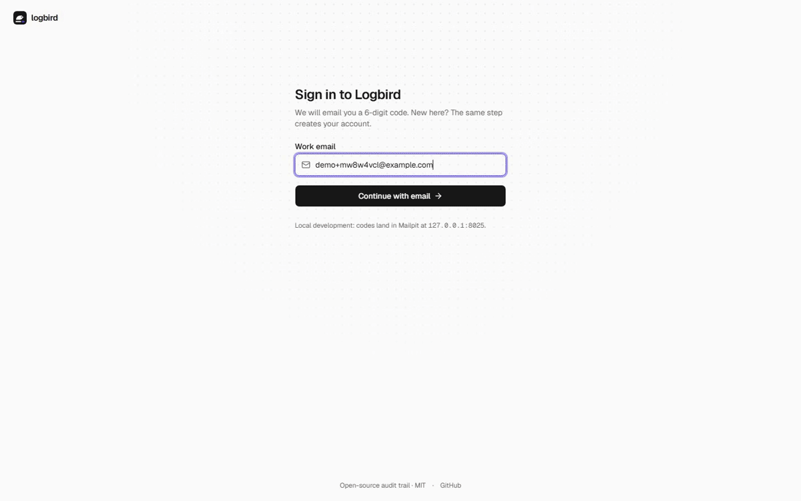
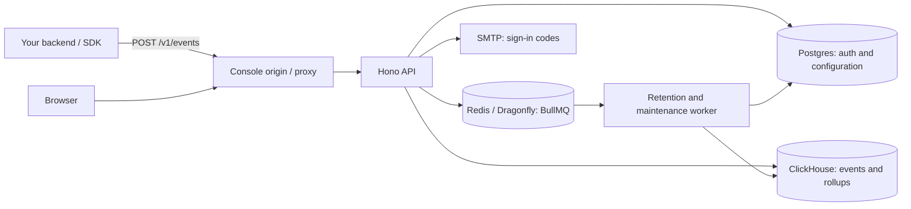

# Logbird

**Retrace every step. Open-source audit logs for your product.**



[](https://github.com/joodlab/logbird/actions/workflows/ci.yml)
[](https://github.com/joodlab/logbird/releases)
[](LICENSE)
[](https://github.com/orgs/joodlab/packages?repo_name=logbird)

Send events through HTTP or the TypeScript SDK. Search who did what, inspect before/after changes, follow a record's history, and trace the background jobs behind an operation. Self-host the whole platform on your infrastructure.

[Watch the video](docs/media/walkthrough.webm) · [Self-hosting](docs/self-hosting.md) · [Documentation](docs/concepts.md) · [Contributing](CONTRIBUTING.md)

## Features

- **Search your history:** structured filters, autocomplete, saved views and guarded SQL expressions.
- **Understand every change:** actors, tenants, executors, target records, before/after diffs and operation trees.
- **Watch activity arrive:** live tail, overview charts and entity timelines.
- **Accept your events:** only `action` is required; keep custom metadata and original payloads.
- **Control access and retention:** workspaces, project-scoped ingest/read keys, roles and retention policies. Expired events are permanently deleted.
- **Store before acknowledging:** `202` follows ClickHouse insertion. Exact retries with the same immutable event ID do not repeat rollup counts; conflicting content is rejected.
- **Keep it yours:** MIT license, Docker Compose deployment and a TypeScript monorepo.

## Quick start

Requires Docker Engine with Docker Compose and an SMTP provider for sign-in codes. The release ships `ghcr.io/joodlab/logbird-{app,server,worker,migrate}:0.1.0`.

```sh
git clone https://github.com/joodlab/logbird.git
cd logbird
sh scripts/selfhost-init.sh
# Configure APP_URL and SMTP in .env before starting.
LOGBIRD_VERSION=0.1.0 docker compose pull
LOGBIRD_VERSION=0.1.0 docker compose up -d
```

Open <http://localhost:4600>, sign in with the emailed code, and create a workspace and project. Keep the API and data services private; expose the console origin only. Read the [self-hosting guide](docs/self-hosting.md) for TLS, backups and upgrades.

**Coolify:** add `https://github.com/joodlab/logbird` as a Public Repository ? Docker Compose resource with `/docker-compose.coolify.yml`; follow the [Coolify guide](docs/coolify.md) for domain and SMTP configuration.

## Send your first event

Create an ingest key in your project's Setup page, then run this on your backend:

```sh
export LOGBIRD_INGEST_KEY='your-project-ingest-key'
curl http://localhost:4600/v1/events \
  -H "Authorization: Bearer $LOGBIRD_INGEST_KEY" \
  -H 'Content-Type: application/json' \
  -d '{"action":"booking.confirmed","actor":{"type":"user","id":"user_42"},"targets":[{"type":"booking","id":"booking_1042"}],"changes":[{"field":"status","before":"pending","after":"confirmed"}]}'
```

Or use the TypeScript SDK ([source setup and delivery behavior](packages/sdk/README.md); see that guide for current package availability):

```ts
import { Logbird } from '@logbird/sdk';

const audit = new Logbird({
  endpoint: 'http://localhost:4600',
  apiKey: process.env.LOGBIRD_INGEST_KEY!,
});
audit.track({
  action: 'booking.confirmed',
  actor: { type: 'user', id: 'user_42' },
  targets: [{ type: 'booking', id: 'booking_1042' }],
  changes: [{ field: 'status', before: 'pending', after: 'confirmed' }],
});
await audit.shutdown(); // Drain pending events before exiting.
```

Open Explorer to find `action:booking.confirmed`. Never send passwords or tokens as event data, or put private ingest keys in a public browser bundle.

## Architecture at a glance



The console uses React and TanStack Start. Shared contracts define the API, Prisma manages Postgres, and ClickHouse powers event search and analytics. See [SPEC](docs/SPEC.md) and [architecture decisions](docs/decisions.md).

## Documentation

- [Concepts and event envelope](docs/concepts.md) · [Query language](docs/query-language.md)
- [SDK](packages/sdk/README.md) · [Backend integration](docs/integrating-a-backend.md) · [Framework integrations](docs/integrations.md) · [Examples](examples)
- [Self-hosting](docs/self-hosting.md) · [Coolify](docs/coolify.md) · [Releases and upgrades](docs/releases.md)
- [Security policy](SECURITY.md) · [Code of Conduct](CODE_OF_CONDUCT.md)
- API reference: `/docs` on your console origin; OpenAPI: `/openapi.json`.

## Contributing

Start with [CONTRIBUTING.md](CONTRIBUTING.md) for development setup, checks and PR conventions. Look for [good first issues](https://github.com/joodlab/logbird/issues?q=is%3Aissue%20is%3Aopen%20label%3A%22good%20first%20issue%22), or discuss a proposal in [Discussions](https://github.com/joodlab/logbird/discussions).

Thanks to everyone building Logbird:

[](https://github.com/joodlab/logbird/graphs/contributors)

## License

[MIT](LICENSE).
