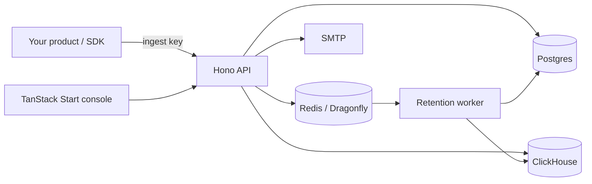

# Logbird

Open-source audit logs and activity history for your product. Send events through HTTP or the TypeScript SDK, then search who did what, follow records and background jobs, and trace changes across an operation.


- Structured filters, autocomplete and guarded SQL expressions.
- Actor, tenant, executor and record timelines; before/after changes and causation trees.
- Live activity, charts, saved views and workspace activity.
- Workspaces, API keys and project retention. Retention permanently deletes expired events.
- ClickHouse durable insert acknowledgement. Delivery is at least once; counts may include duplicates.

## Quickstart

Self-host the application with Docker Compose:

```sh
git clone https://github.com/joodlab/logbird.git
cd logbird
sh scripts/selfhost-init.sh
# Configure SMTP in .env, or explicitly set AUTH_LOG_SIGN_IN_CODES=true.
docker compose build migrate
docker compose build server
docker compose build worker
docker compose build app
docker compose up -d --no-build
```

Open http://localhost:4600, sign in using the emailed code (or server logs when explicitly enabled), and create a workspace and project. Copy its ingest key and send:

```sh
export LOGBIRD_INGEST_KEY=lb_ingest_...
curl http://localhost:4600/v1/events -H "Authorization: Bearer $LOGBIRD_INGEST_KEY" -H 'Content-Type: application/json' -d '{"action":"document.updated"}'
```

Only action is required. Never send passwords or tokens. See [self-hosting](docs/self-hosting.md) for TLS, proxies, upgrades and backups; [Coolify](docs/coolify.md) for Compose builds; [CONTRIBUTING.md](CONTRIBUTING.md) for source development; the [SDK](packages/sdk/README.md), [concepts](docs/concepts.md), [query language](docs/query-language.md), [integrations](docs/integrations.md), [examples](examples), and the API reference at your Logbird origin's `/docs` (http://localhost:4600/docs locally; OpenAPI at `/openapi.json`).

## Architecture



[Deployment](docs/deployment.md) · [Security](SECURITY.md) · [Contributing](CONTRIBUTING.md)

MIT licensed. See [LICENSE](LICENSE).
