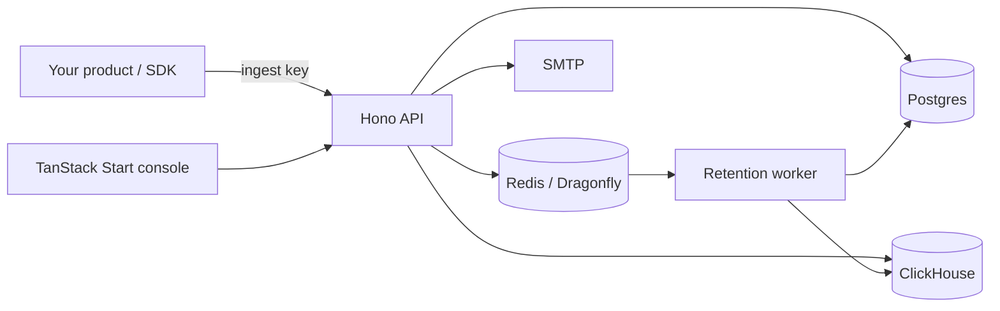

# Trailmark

Open-source audit logs and activity history for your product. Send events through HTTP or the TypeScript SDK, then search who did what, follow records and background jobs, and trace changes across an operation.


- Structured filters, autocomplete and guarded SQL expressions.
- Actor, tenant, executor and record timelines; before/after changes and causation trees.
- Live activity, charts, saved views and workspace activity.
- Workspaces, API keys and project retention. Retention permanently deletes expired events.
- ClickHouse durable insert acknowledgement. Delivery is at least once; counts may include duplicates.

## Quickstart

For managed cloud, a public signup URL will be announced by the maintainers. Self-host the same application today:

```sh
cp .env.example .env
# Fill credentials and URLs per docs/self-hosting.md.
docker compose build
docker compose up -d postgres clickhouse redis
```

Complete migrations and restricted query-user setup in [self-hosting](docs/self-hosting.md), then start the applications. For source development see [CONTRIBUTING.md](CONTRIBUTING.md).

Create a workspace and project in the console, copy its ingest key, and send:

```sh
curl "$BASE_URL/v1/events" -H "Authorization: Bearer $TRAILMARK_INGEST_KEY" -H 'Content-Type: application/json' -d '{"action":"document.updated"}'
```

Only action is required. Never send passwords or tokens. See the [TypeScript SDK](packages/sdk/README.md), [concepts](docs/concepts.md), [query language](docs/query-language.md), and your server's `/docs` API reference. See [Hono, TanStack Start, Vue and Nuxt integrations](docs/integrations.md) and runnable [examples](examples).

## Architecture



[Deployment](docs/deployment.md) · [Security](SECURITY.md) · [Contributing](CONTRIBUTING.md)

MIT licensed. See [LICENSE](LICENSE).
