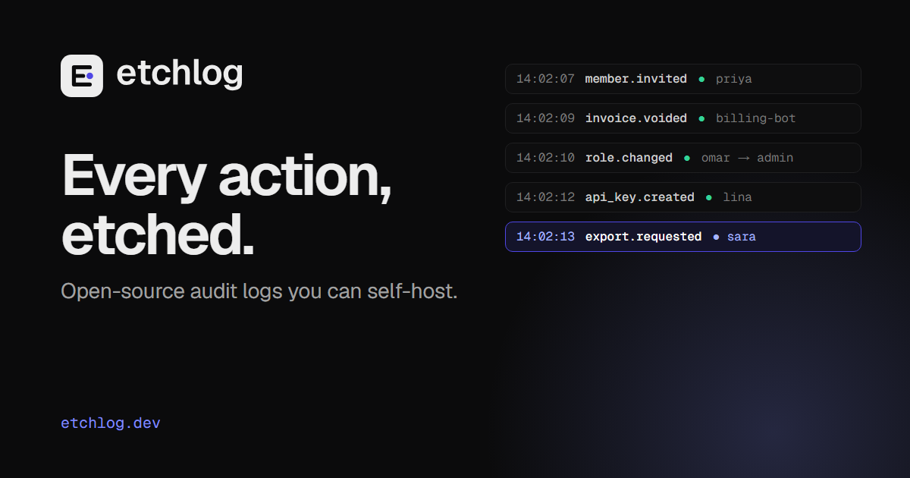

# Brand: name, domain and identity

Status: **proposal, waiting for the owner's decision.** Nothing in the code, packages or docs has been renamed.
Research date: 2026-11-05. Re-run the checks before buying anything: availability changes daily.

## 1. Is "Trailmark" usable?

**No. Rename before the open-source launch.** The name is crowded in exactly our category, and we cannot own the
package namespaces it needs.

| Check | Result |
| --- | --- |
| Security dev tools | [trailofbits/trailmark](https://github.com/trailofbits/trailmark) is a Trail of Bits code-graph security tool, published 2026-03 with about 526 stars. Trail of Bits also owns the [`trailmark` PyPI package](https://pypi.org/project/trailmark/). Another project, [parsiya/trailmark-mcp-server](https://github.com/parsiya/trailmark-mcp-server), is built on it. Same audience (security engineers) and a well-known publisher. |
| npm | The `@trailmark` scope is taken: `@trailmark/core` and `@trailmark/playwright` are published by another maintainer (2026-02). The unscoped `trailmark` package is taken too. **We could not publish our SDK as `@trailmark/sdk`.** |
| GitHub | The `trailmark` organisation exists (created 2026-02). |
| Trademarks | Trailmark Inc. holds TRAILMARK in Class 36 (financial). TRAILMARK STATION was filed 2025-09. Trailmark Systems Inc. sells "Trailmark" field-data SaaS. None is in Class 9/42 software for audit logging, but together they add noise and search competition. |
| Domains | trailmark.com, .dev, .io and .app are registered. Only .sh and .so are free. |
| Social | `trailmark.bsky.social` and youtube.com/@trailmark are taken. |

## 2. Shortlist

How the checks were made, all live on 2026-11-05:

- .com: Verisign RDAP.
- .dev and .app: Google Registry RDAP.
- .io, .sh and .so: the registry WHOIS servers on port 43.
- npm scope: registry `-/org/<name>/package` (404 means free).
- npm package: `registry.npmjs.org/<name>`.
- GitHub: `GET /users/<name>`.
- Bluesky: `resolveHandle` on `<name>.bsky.social`.
- YouTube: `@<name>`.

Each check was calibrated against a known-registered and a known-free control. **X/Twitter and Reddit could not be
checked without signing in, so they are unverified.**

Prices are Porkbun list prices from its public pricing API on 2026-11-05, as first year / renewal in USD:

| TLD | First year | Renewal |
| --- | --- | --- |
| .com | $11.81 | $11.81 |
| .dev | $8.75 | $12.87 |
| .app | $8.75 | $14.93 |
| .io | $28.12 | $51.80 |
| .sh | $31.20 | $46.65 |
| .so | not sold by Porkbun | about $57.50 at Dynadot (third-party tracker [domainoffer.net](https://domainoffer.net/tld/so?page=1), 2026-07 snapshot) |

Registries can mark individual names as premium, and that only shows at checkout. The names below are uncommon
compounds, so that is unlikely, but confirm the price in the cart.

Trademark checks were web searches of USPTO aggregators (Justia, trademarkdir, markinton, gleanmark) and the open web.
**This is a screen, not clearance.** Have counsel run a USPTO/EUIPO/WIPO knock-out search on the chosen name before
launch.

| # | Name | Rationale | Free domains | npm `@scope` / pkg | GitHub org | Bluesky / YouTube | Conflicts found |
| --- | --- | --- | --- | --- | --- | --- | --- |
| **1** | **Etchlog** | To etch is to cut a mark that stays. That is what an append-only audit log promises. It is short (7 letters, 2 syllables), says itself, and is spelled the way it sounds. | **.dev**, .app, .io, .sh, .so (.com is registered at Cloudflare since 2026-02 and has no site) | free / free | free | free / free | None found. Nearest is ettercap's `etterlog`, a different word. |
| 2 | Deedmark | Every deed (action), marked. It keeps the "-mark" ending, so the change from Trailmark is the smallest. | .dev, .io, .sh, .so (.com held since 2017, no site) | free / free | free | free / free | None found. "Deed" leans toward real estate in search. |
| 3 | Stelelog | A stele is a public record carved in stone. **It is the only candidate with a free .com.** | **.com**, .dev, .app, .io, .sh, .so | free / free | free | free / free | STELLOG (Class 9 software, KR applicant, 2022) is close in sound. Many people don't know the word "stele", and it is pronounced two ways. The mark reads as a gravestone. |
| 4 | Chiselmark | Carved, permanent, made by hand. | .dev, .app, .io, .sh, .so (.com parked) | free / free | free | free / taken (YouTube) | None found. 10 letters, long for a CLI or package name. |
| 5 | Deedtrail | Keeps "trail" (an audit *trail*) and changes the noun. | .dev, .app, .io, .sh, .so | free / free | free | free / free | None found. Easy to misread as "Debtrail", an existing finance app. |
| 6 | Actorlog | Plain and descriptive: the log of what actors did. "Actor" is our own core term. | .dev, .app, .io, .sh, .so | free / free | free | free / taken (YouTube) | None found. Too generic to protect as a trademark. |
| 7 | Logwright | A wright is a maker: the craftsman of logs. | .dev, .io, .sh, .so | free / free | free | free / taken (YouTube) | None found. Says less about *audit*. |

Rejected after checking:

- **Auditmark**: Dominion Voting Systems holds a live Class 9 registration (US 4269144).
- **Blazemark**: a live Class 9 software registration (US 4118445, Fire Planning Associates).
- **Cairnlog**: the GitHub org is in use by a Claude plugin project (2026-03).
- **Ostrakon**: Ostrakon Software GmbH exists.
- **Notchlog**: its GitHub org was created on 2026-11-04.
- Waymark, Stele, Cairn, Quipu and Tessera: every useful namespace is taken.

### Recommendation: **Etchlog**, on **etchlog.dev**

It is the strongest name that is also clear everywhere we need it. We can have the npm scope (`@etchlog/sdk`), the
GitHub org, the Bluesky and YouTube handles, and every developer TLD except .com.

The metaphor carries the product's main promise: events are written once and kept. It also gives a mark that holds
up at 16 px. `.dev` is HSTS-preloaded and reads as a developer tool, which is our audience.

Buy these:

| Domain | Cost (first year / renewal) | Use |
| --- | --- | --- |
| etchlog.dev | $8.75 / $12.87 | Primary |
| etchlog.sh | $31.20 / $46.65 | Install-script and CLI vanity |
| etchlog.app | $8.75 / $14.93 | Cloud console |

etchlog.io is optional ($28.12 / $51.80). Total for the three: **$48.70 first year, $74.45 per year after.**

Then:

- Watch etchlog.com: it is registered with no site, so later approach the holder or a broker.
- Claim the namespaces the same day: the npm org `etchlog`, the GitHub org `etchlog`, Bluesky `etchlog.bsky.social`,
  YouTube `@etchlog`, X `@etchlog` (unverified) and Discord vanity.

If a .com from day one matters more than everything else, choose **Stelelog**, accepting its spelling and
gravestone problems.

## 3. Mockups

All screenshots are of the real console (dev server, demo data). Only the brand mark and name were swapped in the DOM.
No code was renamed.

| | Console | Sign-in | README hero |
| --- | --- | --- | --- |
| Etchlog |  |  |  |
| Etchlog (dark) |  |  |  |
| Deedmark |  |  |  |
| Stelelog |  |  |  |

Logo concepts at 16, 32 and 64 px, on light and dark:


## 4. Brand basics (Etchlog)

### Positioning

> **Every action, etched.** Etchlog is the open-source audit log for your product. Send who-did-what events over HTTP
> or the SDK, search them in seconds, and run it on your own servers or ours.

- **For** product engineers who owe their customers an audit trail, and the operators who must keep it.
- **Instead of** building one on Postgres, or renting a closed one (WorkOS Audit Logs, Pangea) where the data never
  leaves the vendor.
- **Because** it is MIT-licensed, self-hosts with `docker compose up`, stores events in ClickHouse, and says plainly
  what it guarantees (at-least-once delivery, permanent retention deletes).

### Voice

Write like an operator talking to a colleague on call.

- **Plain and precise.** "Retention permanently deletes expired events." Not "smart data lifecycle".
- **Say the guarantee and the limit together.** "Delivery is at least once; counts may include duplicates."
- **Short sentences and real verbs.** Avoid "seamless", "blazing", "revolutionary", "AI-powered" and exclamation marks.
- **Show the command.** A curl line beats a paragraph.
- Lowercase `etchlog` in code, CLI and the wordmark. "Etchlog" with a capital E in prose.

### Logo

- **Mark:** a capital E built from three log rows, with the middle row cut short and an indigo dot where the next
  entry lands. Read as "E", as a stack of log lines, or as a cursor on the newest record.
- **Files:** `apps/app/public/brand/`

| File | Use |
| --- | --- |
| `etchlog-mark.svg` | Dark tile, for light backgrounds |
| `etchlog-mark-dark.svg` | Light tile, for dark backgrounds |
| `etchlog-favicon.svg` | Follows `prefers-color-scheme` |
| `etchlog-apple-touch-icon.png` | 180 px |
| `etchlog-wordmark-light.svg` and `etchlog-wordmark-dark.svg` | Lockups |
| `etchlog-wordmark-text.svg` | `currentColor`, text only |
| `etchlog-og.png` | 1200×630 |

- **Wordmark:** Geist SemiBold 600, tracking −2.5 %, outlined to paths so it renders the same everywhere. Geist is
  under the SIL OFL, which allows a logo built from its outlines.
- **Spacing and size:** clear space of half the mark's height on every side. Minimum size is 16 px for the mark and
  80 px wide for the lockup.
- **Don't:** recolour the dot anything but brand indigo, add gradients or shadows, rotate it, or set the wordmark in
  another font.

### Colour tokens

The identity reuses the console theme in `packages/ui/src/styles/globals.css`, so the product and the brand never
drift apart. There are no new hues.

| Token | Light | Dark | Role |
| --- | --- | --- | --- |
| `--brand` | `#4f46e5` | `#818cf8` | Indigo: the etched entry. Accents, links, focus ring, chart-1. |
| `--foreground` | `#171717` | `#ededed` | Ink: mark tile, wordmark, primary buttons |
| `--background` | `#fafafa` | `#0b0b0c` | Paper and night |
| `--muted-foreground` | `#6b6b6b` | `#a0a0a0` | Secondary copy |
| `--border` | `#e6e6e6` | `#242426` | Hairlines |
| `--chart-2` | `#0891b2` | `#22d3ee` | Secondary accent (sparingly) |
| `--outcome-success` | — | — | The green "●" in log rows; never used as a brand colour |

On the dark tile the dot uses `#818cf8`. On the light tile (dark mode) it uses `#4f46e5`, for contrast.

### Typography

Geist (UI and headings) and Geist Mono (code, event names, log rows), as the console already ships through
`@fontsource-variable`.

### Social and OG

`etchlog-og.png` shows the lockup, the line "Every action, etched.", the descriptor, a stack of log rows with the
newest highlighted in indigo, and the domain.



### README hero

```html
<p align="center">
  <picture>
    <source media="(prefers-color-scheme: dark)" srcset="apps/app/public/brand/etchlog-wordmark-dark.svg">
    
  </picture>
</p>
<p align="center"><b>Every action, etched.</b><br>Open-source audit logs you can self-host. Send who-did-what events, search them in seconds.</p>
<p align="center"><a href="#quickstart">Quickstart</a> · <a href="docs/self-hosting.md">Self-hosting</a> · <a href="docs/concepts.md">Docs</a></p>
```

## 5. After the owner picks a name

The rename happens only after approval, as one mechanical PR. It touches the npm scope `@trailmark/*` →
`@<name>/*` in every `package.json`, the imports and `pnpm-lock.yaml`.

Code and config:

- `BrandMark` and `BrandLockup` in `apps/app/src/components/brand.tsx`, plus the favicon and OG meta.
- User-facing strings and emails.
- The OpenAPI title and the regenerated `openapi/` output.
- The API key prefixes `tm_ingest_` and `tm_read_`: keep the old ones accepted.
- `BULLMQ_PREFIX`, the ClickHouse database and the query user name. **These stay as they are for existing installs**:
  only defaults for new installs change, and the upgrade notes say so.
- Docker image names, the compose project name and the docs.

Coordinate it with the feature/JoodCMS thread, which may have open PRs touching the same files.
